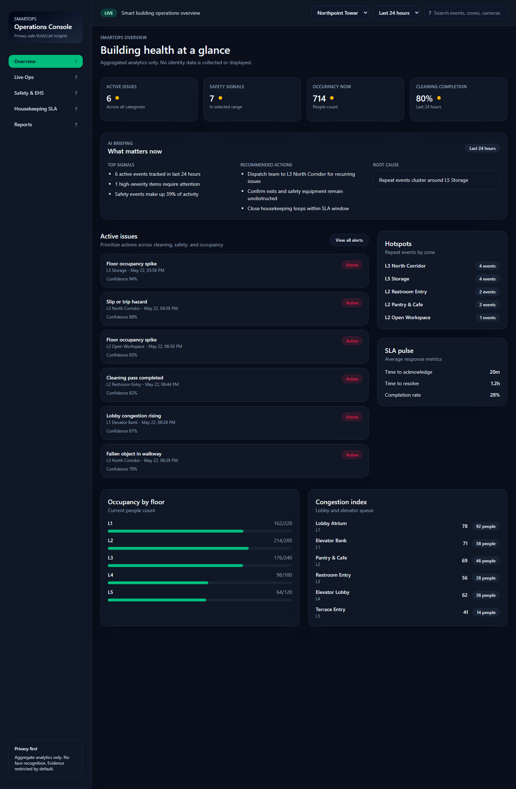
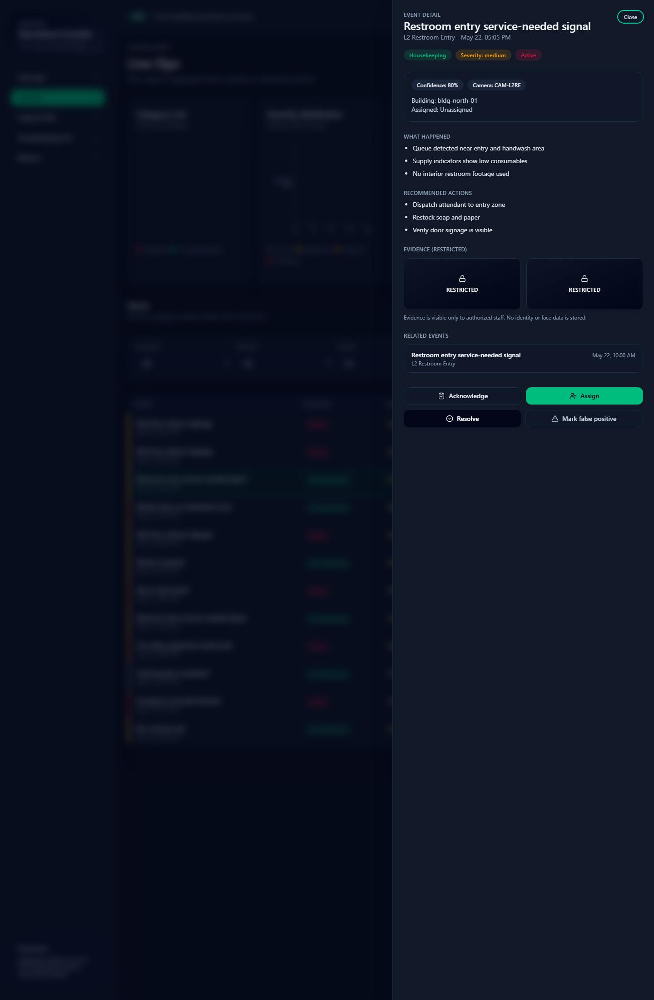
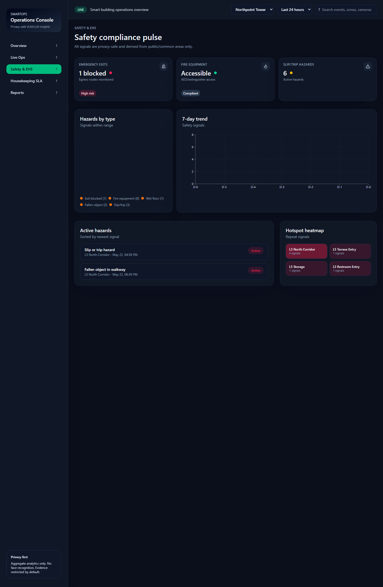
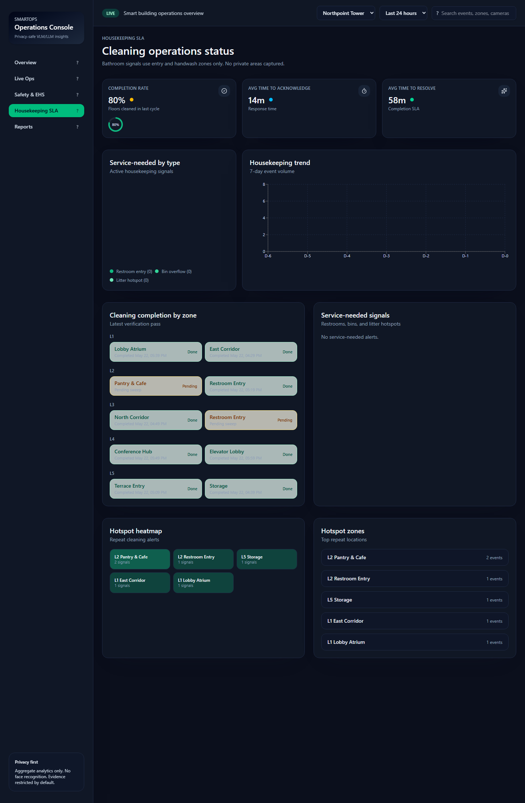
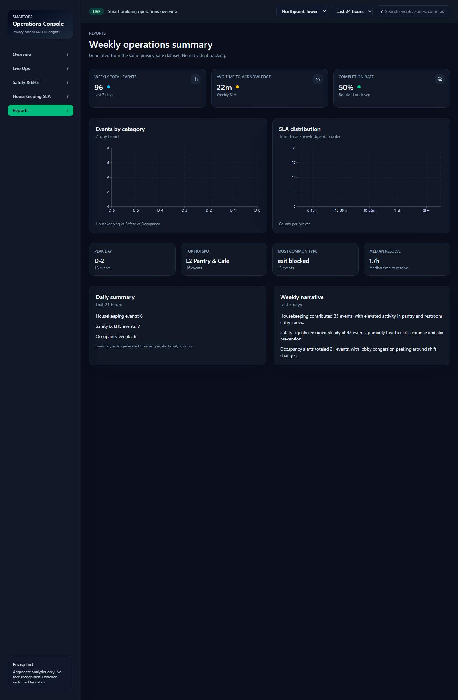

# SmartOps Presentation Script

## Run the project

Use this sequence:

```bash
npm install
npm run build
npm run start
```

Open `http://localhost:3000`.

Note: `npm run dev` hit a local lock/root issue in this workspace, so `build` + `start` was the stable way to run the app for presentation.

## What this project is

SmartOps is a smart-building operations dashboard. It turns privacy-safe CCTV analytics into action-oriented operations insights across safety, housekeeping, and occupancy.

## What it helps with

- It helps facilities and operations teams detect issues faster.
- It helps teams prioritize high-risk events instead of scanning raw camera feeds.
- It helps teams track response and resolution SLAs.
- It helps teams stay privacy-conscious because the app uses aggregated signals and restricted evidence views instead of identity tracking.

## Main features

- Executive overview with KPIs, hotspots, occupancy, and AI briefing.
- Simulated realtime CCTV monitoring demo for presentation use.
- Unified Live Ops screen for alerts across categories.
- Event detail workflow with `Acknowledge`, `Assign`, `Resolve`, and `Mark false positive`.
- Safety & EHS deep dive for blocked exits, fire equipment access, and slip/trip hazards.
- Housekeeping SLA deep dive for cleaning completion and service-needed signals.
- Reports page with daily summary, weekly narrative, trend charts, and SLA distribution.

## Important framing

Be explicit in the demo:

- This repo is frontend-only.
- The `Realtime Demo` page is a simulated playback demo.
- It shows how CV detections would appear in the product UX.
- It does not claim there is a live backend inference pipeline in this project.

That framing is important because it is accurate and still lets you demonstrate the intended product behavior.

## Screen 1: Realtime Demo

Route: `/realtime-demo`

### What to say

"Because this project is frontend-only, this screen is presented as a simulated playback demo of how a computer vision monitoring workflow would look in production. The camera panel represents a CCTV feed, the detection boxes represent scene-level events identified by the model, and the feed on the right shows how those detections would be classified and routed into operations. The value is not that an operator watches footage all day, but that the system turns camera observations into actionable building events like congestion, cleaning issues, or blocked exits."

### What to point at

- Simulated camera feed
- Detection boxes over the scene
- Detection feed with active, queued, and resolved states
- Playback timeline
- Demo narration panel

## Screen 1: Overview

Route: `/`



### What to say

"This is the SmartOps overview dashboard. The goal is to give building operators one place to understand what is happening right now across safety, housekeeping, and occupancy. At the top, you can see the main KPIs like active issues, safety signals, occupancy, and cleaning completion. In the middle, the AI Briefing summarizes what matters now and suggests the next actions. On the lower half, the dashboard shows active issues, hotspot zones, SLA pulse, floor occupancy, and congestion trends. The key value here is that the operator gets a clear operational picture without reviewing raw surveillance footage."

### What to point at

- KPI cards
- AI Briefing panel
- Active issues list
- Hotspots and SLA pulse
- Occupancy by floor and congestion index

## Screen 2: Live Ops Event Workflow

Route: `/live-ops?event=EVT-9`



### What to say

"This is the Live Ops screen, where alerts are operationalized. On the right, the event drawer opens for a specific issue and shows the event summary, severity, confidence score, zone, restricted evidence, and recommended actions. This is where the operations team moves from visibility to response. They can acknowledge the alert, assign it to a team, resolve it, or mark it as a false positive. This turns AI detection into a real workflow instead of just another dashboard notification."

### What to point at

- Event detail drawer
- Confidence score and camera reference
- Recommended actions
- Restricted evidence section
- Action buttons: `Acknowledge`, `Assign`, `Resolve`, `Mark false positive`

## Screen 3: Safety & EHS

Route: `/safety`



### What to say

"This screen focuses on safety compliance. It helps operators monitor blocked emergency exits, obstructed fire equipment, and slip or trip hazards. The top KPI cards show the most important compliance risks immediately. Below that, trend and hazard charts help teams understand whether problems are isolated or recurring. This screen is useful for EHS reviews because it turns camera-based observations into measurable safety indicators."

### What to point at

- Emergency exits KPI
- Fire equipment KPI
- Slip/trip hazards KPI
- Hazard type donut chart
- Trend line and hotspot heatmap

## Screen 4: Housekeeping SLA

Route: `/housekeeping`



### What to say

"This screen is for housekeeping operations and SLA tracking. It shows cleaning completion, average acknowledge time, and average resolve time. The middle section breaks down service-needed signals like restroom entry issues, bin overflow, and litter hotspots. The lower sections show cleaning completion by zone and repeat hotspot areas. So instead of waiting for complaints, the facilities team can use these signals to respond earlier and manage cleaning performance more proactively."

### What to point at

- Completion rate
- Average acknowledge and resolve time
- Service-needed chart
- Cleaning completion by zone
- Hotspot heatmap and hotspot zones

## Screen 5: Reports

Route: `/reports`



### What to say

"The Reports screen turns the same operational data into management-ready summaries. It shows weekly event totals, SLA performance, category trends, and response-time distribution. It also provides a daily summary and a weekly narrative, which makes it easier to explain building performance to management without manually compiling data. This is useful for reviews, stakeholder updates, and continuous improvement discussions."

### What to point at

- Weekly KPI cards
- Category trend chart
- SLA distribution chart
- Insight cards like peak day and top hotspot
- Daily summary and weekly narrative

## 90-second short version

"SmartOps is a privacy-safe building operations dashboard. It helps facilities teams monitor safety, housekeeping, and occupancy from aggregated CCTV analytics without relying on identity tracking. The overview page gives leaders a quick operational snapshot with KPIs, hotspots, and AI-generated priorities. Live Ops turns alerts into actions with acknowledgement, assignment, and resolution workflows. The Safety and Housekeeping pages provide focused operational views for compliance and SLA management, and the Reports page turns all of that activity into management-ready summaries and trends."

## Suggested closing line

"In short, this project helps building teams move from passive monitoring to faster, measurable, and privacy-conscious operations management."
